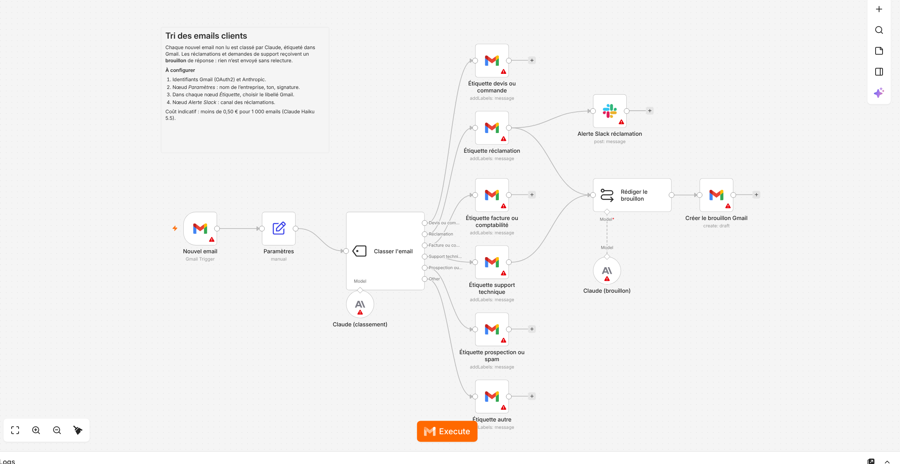
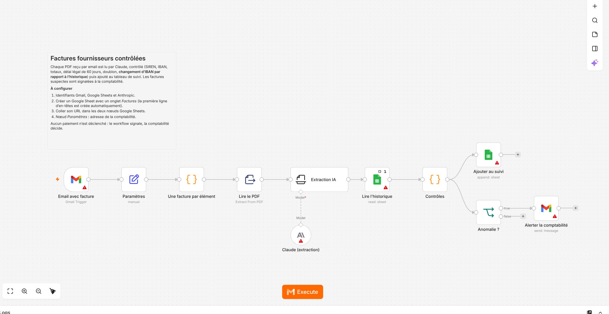
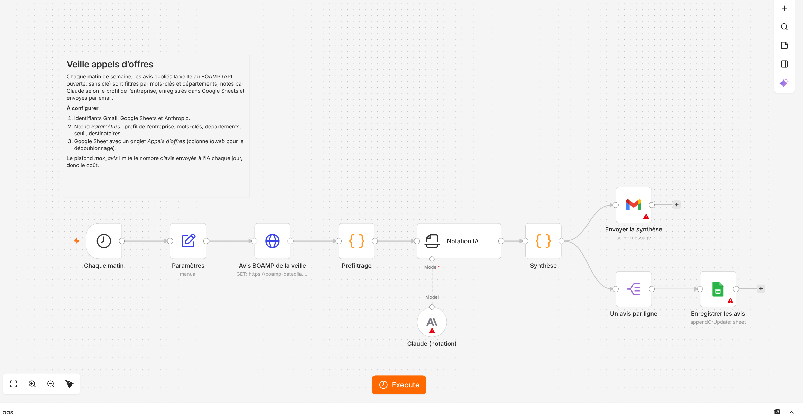

# Automatisations n8n + IA prêtes à déployer

Trois workflows n8n qui utilisent Claude pour des tâches que toutes les PME connaissent, livrables au
forfait en quelques jours. Chacun garde un humain dans la boucle : rien n'est envoyé, payé ou validé
automatiquement.

*EN — Three production-ready n8n workflows powered by Claude: customer email triage with reply drafts,
supplier invoice extraction with fraud checks, and AI-scored public tender monitoring (BOAMP open data).
Validated in a real n8n 2.44 instance; Code-node logic covered by tests.*

| Workflow | Problème réglé | Nœuds |
|---|---|---|
| [**Tri des emails clients**](workflows/01_tri_emails.json) | La boîte de contact déborde, les réclamations attendent | Gmail → classement Claude → étiquettes → brouillons de réponse + alerte Slack |
| [**Factures fournisseurs contrôlées**](workflows/02_factures_controlees.json) | Saisie manuelle des factures, risque de fraude au changement de RIB | Gmail → PDF → extraction Claude → contrôles → Google Sheets + alerte comptabilité |
| [**Veille appels d'offres**](workflows/03_veille_appels_offres.json) | Des heures perdues à éplucher le BOAMP | API BOAMP → préfiltrage → notation Claude → Google Sheets + synthèse par email |

L'offre commerciale correspondante (forfaits, délais, coûts de fonctionnement) est dans [OFFRE.md](OFFRE.md).

## 1. Tri des emails clients et brouillons de réponse



- Chaque email non lu est classé par Claude en 5 catégories : devis ou commande, réclamation, facture, support technique, prospection. Les emails hors catégorie vont dans « Autre ».
- Chaque email reçoit l'étiquette Gmail de sa catégorie.
- Les réclamations et demandes de support reçoivent un **brouillon** de réponse dans le fil Gmail. Le ton, la signature et les règles (« ne jamais promettre de remboursement ») se règlent dans le nœud *Paramètres*.
- Chaque réclamation déclenche une alerte Slack.

## 2. Factures fournisseurs contrôlées



- Chaque PDF reçu par email devient une ligne du tableau de suivi. Plusieurs factures dans un même email sont traitées séparément.
- Claude extrait les champs avec un schéma strict : fournisseur, SIREN, numéro, dates, montants, IBAN.
- **Contrôles** appliqués à chaque facture :
  - clé de contrôle du SIREN et de l'IBAN ;
  - HT + TVA = TTC ;
  - délai de paiement supérieur à 60 jours ;
  - doublon par rapport aux factures déjà enregistrées ;
  - **IBAN différent de celui connu pour ce fournisseur**, signal classique de fraude au faux RIB.
- Statut de chaque facture : `OK`, `À vérifier` ou `À BLOQUER`. Une facture qui n'est pas `OK` déclenche un email à la comptabilité avec le détail.

Même logique de contrôle que le projet FactuAgent (dépôt `factuagent`), dans un format que le client peut modifier lui-même.

## 3. Veille appels d'offres BOAMP qualifiée par IA



- Chaque matin de semaine, le workflow récupère les avis publiés depuis le dernier jour ouvré, via l'API ouverte du BOAMP (sans clé). La pagination est gérée.
- Un **préfiltrage** gratuit écarte les attributions, rectificatifs et doublons, puis filtre par mots-clés et départements. Il plafonne à `max_avis` le nombre d'avis envoyés à l'IA, ce qui garde le coût prévisible.
- Claude note chaque avis de 0 à 100 selon le **profil de l'entreprise** écrit en clair dans *Paramètres*, avec une justification courte.
- Les avis au-dessus du seuil sont enregistrés dans Google Sheets, dédoublonnés par identifiant d'avis, et envoyés dans une synthèse HTML par email.

## Installation

1. Dans n8n : **Workflows → Import from File**, choisir un fichier de `workflows/`.
2. Créer les identifiants demandés : Gmail (OAuth2), Google Sheets, Anthropic, Slack pour le workflow 1. Les nœuds signalés par un triangle rouge sont ceux qui attendent un identifiant.
3. Remplir le nœud **Paramètres** et suivre la note « Mode d'emploi » du workflow.
4. Tester avec **Execute workflow**, puis activer.

Les nœuds Claude utilisent `claude-haiku-5-5` : rapide, très peu coûteux, suffisant pour classer et extraire.
Le modèle se change dans chaque nœud *Claude*.

## Ce qui a été vérifié

- **Import dans un vrai n8n** (version 2.44.7) : les 3 workflows s'importent et s'ouvrent dans l'éditeur sans erreur de configuration. Il ne manque que les identifiants, ce qui est attendu (captures ci-dessus).
- **Exécution dans n8n** : les nœuds Code des workflows 2 et 3 ont tourné dans le moteur de n8n, alimentés par des données de test à la place de Gmail, du BOAMP et de Claude (`tests/build_test_workflows.py`). Le préfiltrage, la synthèse et les contrôles de facture ont donné les résultats attendus, y compris la détection d'un changement d'IBAN.
- **Tests unitaires** : 9 tests sur la logique des nœuds Code (`node --test tests/logic.test.js`). Le code testé est exactement celui qui est embarqué dans les workflows : `build_workflows.py` l'y copie.
- **Pas testé ici** : les appels réels à Gmail, Google Sheets, Slack, Claude et à l'API BOAMP (identifiants et accès réseau nécessaires). À faire sur l'instance du client lors de la mise en service.

## Structure

```
workflows/               les 3 workflows à importer
src/                     logique des nœuds Code (JavaScript)
build_workflows.py       assemble les workflows à partir de src/
tests/logic.test.js      tests unitaires
tests/build_test_workflows.py   workflows de test exécutés dans n8n
docs/                    captures de l'éditeur n8n
OFFRE.md                 offre commerciale au forfait
```

---

**Auteur :** Fayçal Boubekri — AI & Data Engineer, Paris. Missions au forfait : agents IA, RAG, pipelines de données.
